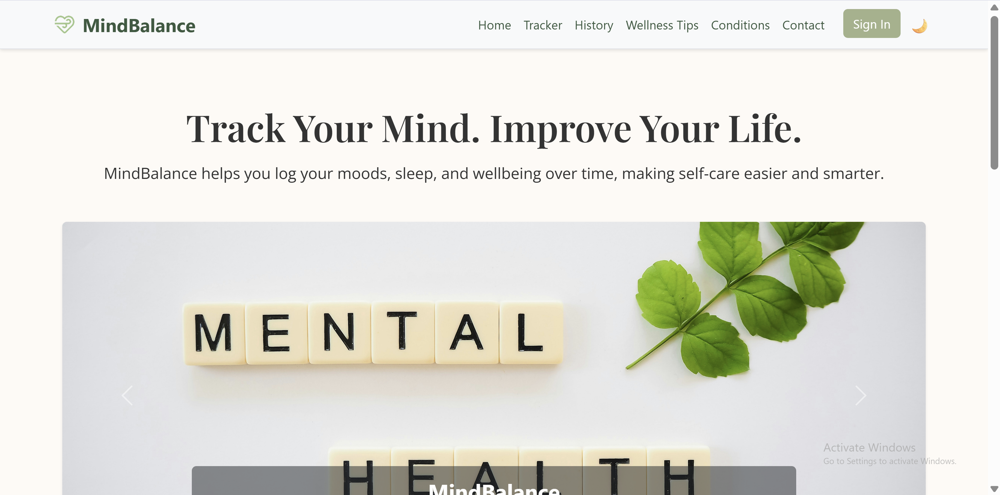
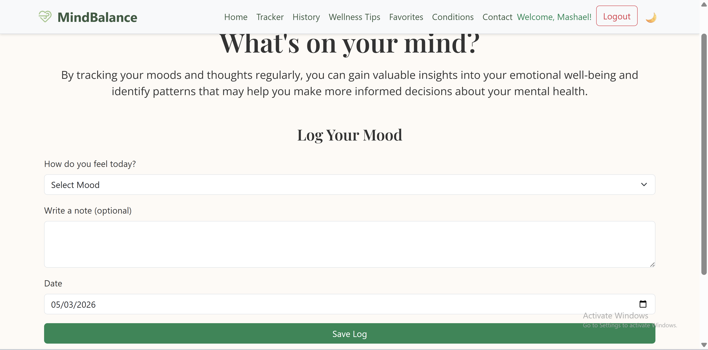
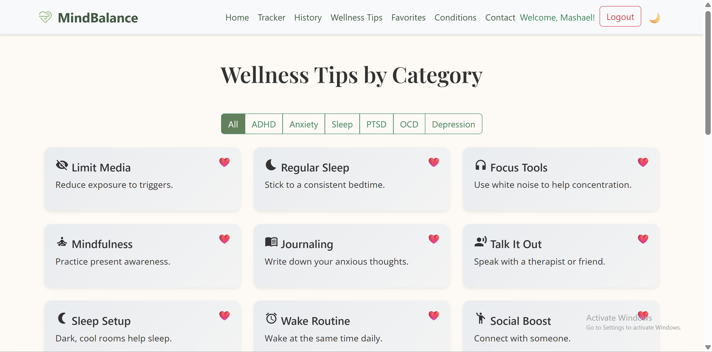
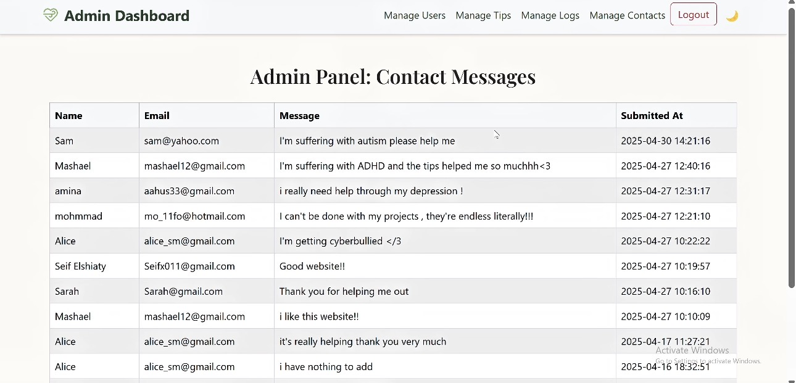

# MindBalance

**PHP · MySQL / MariaDB · JavaScript · Bootstrap**

MindBalance is a collaborative web development project for recording moods, saving wellness tips, and managing user-submitted content. Built as a Computer Science course project at Effat University.

## Features

- User registration and login
- Dated mood logs and history
- Favorite wellness tips
- Contact form and administrative pages for users, tips, and logs
- Light/dark interface mode

## Screenshots

| Home | Mood tracker |
| --- | --- |
|  |  |

| Wellness tips | Admin panel |
| --- | --- |
|  |  |

## Run locally

1. Install XAMPP (PHP 8 and MariaDB/MySQL) or an equivalent local PHP server.
2. Clone this repository into `htdocs/mindbalance`.
3. Start Apache and MySQL/MariaDB, then create a database named `mindbalance_db`.
4. Import [the schema](database/mindbalance_schema.sql) using phpMyAdmin. The schema has tables and constraints but **no saved accounts, journal entries, or password hashes**.
5. The connection defaults to `localhost`, `root` and a blank password for **local XAMPP testing only**. For another setup, configure `MINDBALANCE_DB_HOST`, `MINDBALANCE_DB_NAME`, `MINDBALANCE_DB_USER`, and `MINDBALANCE_DB_PASSWORD` in the PHP environment.
6. Open `http://localhost/mindbalance/index.php` and register a test account.

To explore the admin pages locally, create a test account and set its role to `admin` through phpMyAdmin. Do not expose this example configuration on a public server.

## Project structure

- `*.php` — user pages, form handlers and admin views
- `assets/images/` — site imagery
- `database/` — database schema with no personal records
- `screenshots/` — screenshots from the original project
- `styles.css` — shared styling

The PHP files share one document root, matching the relative routes used by the original application.

## Contributors

**Sarah Elshiaty · Mashael Saeed · Seifeldin Elshiaty**

The original team project and Git commit history are preserved at [Mashael's repository](https://github.com/M1sh13l/MindBalance-Web-App). This version keeps team attribution and uses a sanitized development database. See [CONTRIBUTORS.md](CONTRIBUTORS.md).

## Scope

This is a coursework prototype, not a deployed healthcare service. It has not undergone a full security audit or end-to-end runtime validation. Avoid entering real health information. Check licenses for third-party images before commercial reuse.
